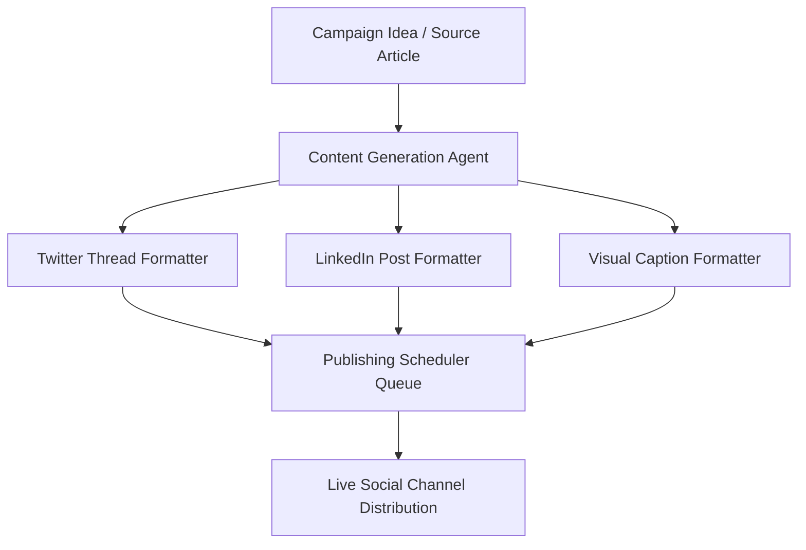

# Multi-Channel Social Content Automation Studio

> Full-stack content generation and cross-platform publishing suite for marketing workflows.

[](https://github.com/sohailahmed-bsrh/social-post-studio)
[](https://sohail.devsil.com/projects.html)
[](https://sohail.devsil.com)

---

## Overview

Content creators and growth teams struggle to maintain consistent publication schedules across disparate social networks with varying format constraints.

This project provides an end-to-end, reproducible implementation engineered to solve this challenge through verified data transformations, reliable algorithms, and production-ready architecture.

---

## Key Features

- Automated copy adaptation for Twitter, LinkedIn, and Instagram character and tone specifications
- Integrated image generator previewing promotional card designs
- Multi-channel scheduling and publication queue management
- TypeScript agents architecture for background automation tasks

---

## System Architecture



---

## Technology Stack

| Technology | Version / Spec | Role in Architecture |
| :--- | :--- | :--- |
| **React & TypeScript** | `18.2+` | Frontend studio interface with live card previews |
| **Node.js & Express** | `18+` | Backend scheduling engine and API connectors |
| **Drizzle ORM** | `0.28+` | PostgreSQL relational data persistence |
| **Tailwind CSS** | `3.3+` | Component design system |

---

## Repository Structure

```text
social-post-studio/
|-- agents/
|   |-- src/
|   `-- package.json
|-- src/
|-- .env.example
|-- .gitignore
|-- package.json
`-- README.md
```

---

## Installation and Execution

### Prerequisites
- Node.js 18+ / Python 3.10+
- Git version control

### Setup Instructions
1. Clone the repository:
```bash
git clone https://github.com/sohailahmed-bsrh/social-post-studio.git
cd social-post-studio
```

2. Configure environment and dependencies:
```bash
npm install
cp .env.example .env
npm run dev
```

---

## Interface and Verification
The system produces verifiable execution logs, prediction matrices, or interactive browser interfaces depending on the target mode. Verify operation by executing the commands specified above or inspecting the demonstration notebooks.

---

## Author and Contact
Developed by **Sohail Ahmed** — Full Stack AI Engineer & Machine Learning Specialist.
- **Portfolio:** [sohail.devsil.com](https://sohail.devsil.com)
- **GitHub:** [@sohailahmed-bsrh](https://github.com/sohailahmed-bsrh)
- **Email:** [sohail.bsrh@gmail.com](mailto:sohail.bsrh@gmail.com)
